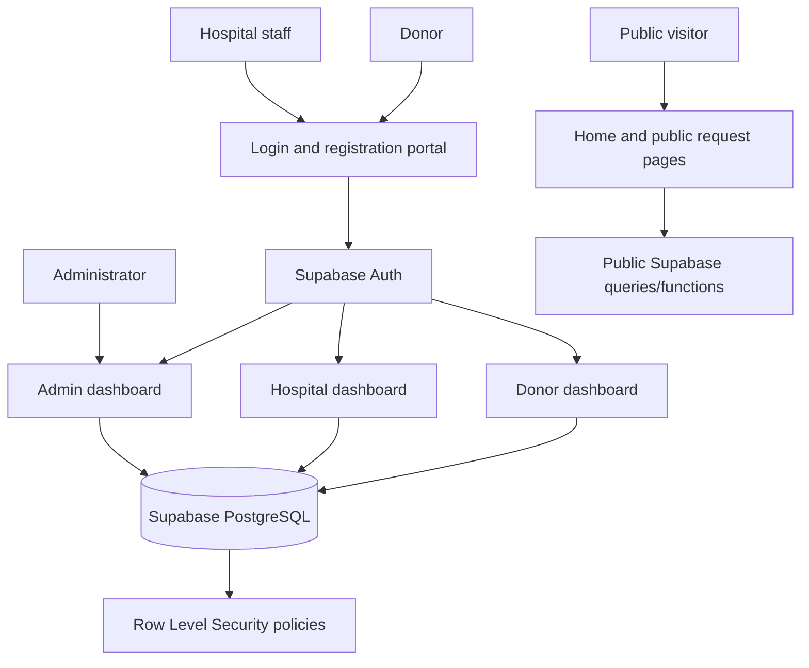
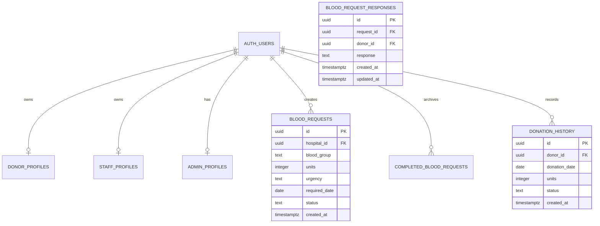
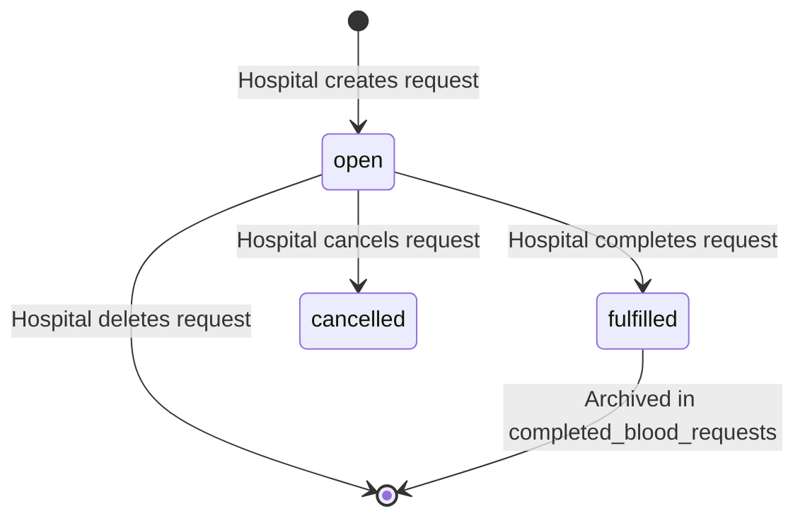

# System Architecture

This document describes the implemented system structure and its security boundaries. Mermaid is used for the system and data-flow diagrams so the diagrams remain editable alongside the source.

## 1. Architectural Style

The application is a static, multi-page frontend with a managed Supabase backend. Each role has dedicated HTML pages and JavaScript behavior. Supabase provides authentication, PostgreSQL data storage, database functions, and Row Level Security.



## 2. Frontend Layers

### Public layer

The public layer contains the home page, public blood-request view, login/registration portal, and password-recovery screens. It does not require a role session for public content.

### Donor layer

The donor layer contains the dashboard, profile fragments, donation recording modal, donation history, emergency request preview, and a consent-based live donor directory.

### Hospital layer

The hospital layer contains the dashboard, request creation form, request lifecycle actions, profile display, and hospital update form.

### Administration layer

The administration layer contains a protected sign-in screen, summary counts, searchable data tabs, and destructive management actions.

## 3. Authentication Flow

1. A user selects Donor or Hospital mode.
2. Registration calls `supabaseClient.auth.signUp` with an `account_type` and profile metadata.
3. When a session is available, the page creates or verifies the matching profile row.
4. Login calls `signInWithPassword`.
5. The page checks account type and verifies the role profile.
6. A small display model is saved in `localStorage`.
7. The user is redirected to the matching dashboard.
8. Logout calls Supabase sign-out and returns the user to the public/login area.

Administrator access uses the same Auth system but adds a database check against `admin_profiles` before displaying the admin dashboard.

## 4. Data Model



The repository SQL defines `blood_requests`, `completed_blood_requests`, `donation_history`, `admin_profiles`, public aggregate functions, administrator checks, and an administrator user-deletion function. The application also expects existing `donor_profiles` and `staff_profiles` tables.

## 5. Request Lifecycle



The current frontend implements creation, open-list loading, editing, cancellation, deletion, and completion/archive behavior.

## 6. Security Boundaries

### Donor boundary

Donors can read, insert, and update only their own donation history. The frontend filters by the authenticated user's ID, and RLS enforces the same ownership rule in the database.

### Hospital boundary

Hospitals can create, update, and delete requests only when the request owner matches `auth.uid()`. Completed request access is also restricted to the owning hospital.

### Public boundary

Anonymous and authenticated visitors can read only open blood requests. Public statistics are returned through aggregate functions instead of exposing private profile rows.

### Administrator boundary

`public.is_admin()` verifies that the current Auth user has an administrator record. Administrator policies and `admin_delete_user` depend on that check. The frontend uses only a publishable Supabase key; privileged service-role credentials must remain server-side.

## 7. State Management

Supabase is the persistent source of truth. `localStorage` is used as a convenience cache for:

- `bloodConnectDonorProfile`.
- `hospitalData`.

Cached values improve dashboard rendering between page loads but are not trusted for authorization. Authorization must come from Supabase Auth and RLS.

## 8. Deployment Model

The application has no build step or server-side application in the repository. It should be served using VS Code Live Server or another static HTTP server. This is required for dynamic HTML fragments loaded with `fetch` and avoids browser restrictions that occur when pages are opened directly from the filesystem.

## 9. Repository Placement

```text
README.md
supabase-blood-requests.sql
docs/
  product-backlog.md
  definition-of-done.md
  architecture.md
  sprint-journals.md
portfolio-6880.md         Software Developer
portfolio-6882.md         Project Owner
portfolio-6883.md         Scrum Master
portfolio-6945.md         UI/UX Designer
pages/                 Application HTML, CSS, and JavaScript by interface
Assets/                Shared images
```

The source code lives under `pages/`; the assignment allows application code to follow the team's chosen organization. The four individual portfolios are kept in the repository root. `README.md` is the entry point for setup and navigation to the four required documents in `docs/`.

## 10. Current Architecture Risks

- Supabase client configuration is repeated in multiple pages.
- Apply the updated SQL before using donor availability, directory consent, or request response workflows.
- Configure Supabase's allowed redirect URL and email template before using password recovery.
- Some dynamic template rendering should receive a consistent escaping review.
- The architecture has no notification service, background job, or server-side application layer.

## 11. Recommended Evolution

1. Centralize shared Supabase client and authentication utilities.
2. Add a small backend or Supabase Edge Functions for notifications and privileged workflows.
3. Replace localStorage profile state with authenticated database reads on protected pages.
4. Extend request-response tracking with in-app or delivered notifications.
5. Add automated browser tests around role isolation and request lifecycle.

